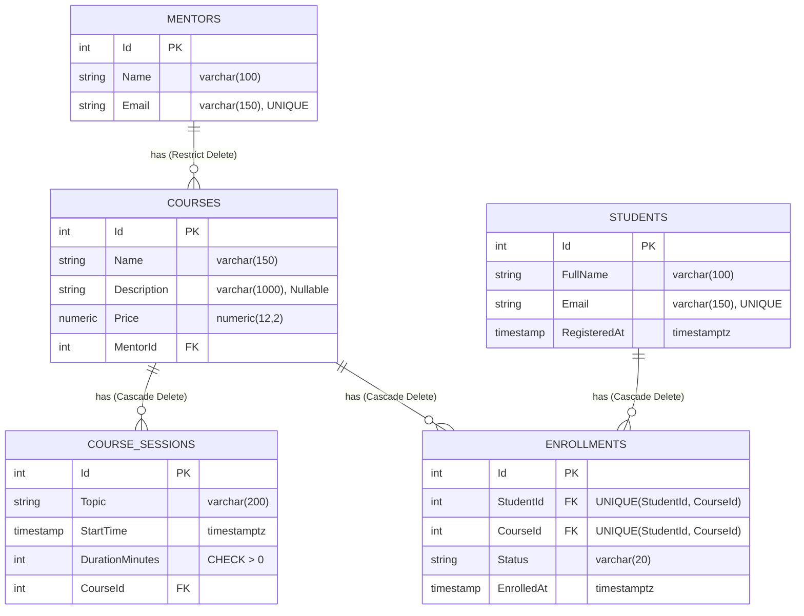

# Bimbel Testing: Database Layer Testing dengan Testcontainers, EF Core & PostgreSQL

Proyek ini adalah implementasi pengujian lapisan database (*Database Layer Testing*) untuk sistem bimbingan belajar (Bimbel) menggunakan **Entity Framework Core**, **PostgreSQL asli**, dan **Testcontainers for .NET**.

Pendekatan ini menjamin bahwa seluruh pengujian constraint, relasi, migrasi, tipe data spesifik PostgreSQL, dan transaksi diuji langsung pada database nyata di dalam container terisolasi, bukan sekadar database tiruan (*mock* / *in-memory*).

---

## 📋 Daftar Isi
1. [Prasyarat Sistem](#-prasyarat-sistem)
2. [Penting: Konfigurasi Akses Docker (Linux / macOS / Windows)](#-penting-konfigurasi-akses-docker)
3. [Struktur Proyek](#-struktur-proyek)
4. [Skema Database & Relasi (ERD)](#-skema-database--relasi-erd)
5. [Arsitektur & Pola Pengujian](#-arsitektur--pola-pengujian)
6. [Instalasi & Build](#-instalasi--build)
7. [Prosedur & Cara Menjalankan Test](#-prosedur--cara-menjalankan-test)
8. [Cakupan Pengujian](#-cakupan-pengujian)
   - [Bagian KADEK: Persistence, Migrations & Mapping](#a-bagian-kadek-persistencetestscs)
   - [Bagian DANEN: Relationships & Constraints](#b-bagian-danen-constrainttestscs)

---

## 💻 Prasyarat Sistem
- **.NET SDK 10.0+** (`dotnet --version`)
- **Docker Engine / Docker Desktop** yang sedang aktif (`docker --version`)
- **EF Core CLI Tool** (opsional untuk migrasi baru):
  ```bash
  dotnet tool install --global dotnet-ef
  ```

---

## 🐳 Penting: Konfigurasi Akses Docker

Testcontainers berkomunikasi langsung dengan Docker daemon melalui socket (`/var/run/docker.sock`). Pastikan user Anda memiliki izin mengakses Docker tanpa `sudo`.

### Untuk Pengguna Linux:
Jika muncul pesan error `permission denied while trying to connect to the docker API at unix:///var/run/docker.sock`:
1. Masukkan akun pengguna ke grup `docker`:
   ```bash
   sudo usermod -aG docker $USER
   ```
2. Aktifkan perubahan grup langsung di sesi terminal:
   ```bash
   newgrp docker
   ```
   *(Atau alternatif cepat untuk sesi pengujian lokal: `sudo chmod 666 /var/run/docker.sock`)*
3. Pastikan daemon Docker menyala:
   ```bash
   sudo systemctl start docker
   docker ps
   ```

### Untuk Pengguna Windows / macOS:
- Pastikan aplikasi **Docker Desktop** sudah dibuka dan berstatus *Engine running*.
- Pada Docker Desktop Settings > *Advanced*, pastikan *Expose daemon on tcp://localhost:2375 without TLS* atau default named pipe aktif.

---

## 📁 Struktur Proyek

```text
.
├── BimbelTesting.slnx                    # Solution file
├── README.md                             # Dokumentasi proyek & panduan pengujian
├── src/
│   └── Bimbel.Data/                      # Proyek EF Core & Entities
│       ├── Configurations/               # Entity type configurations & Fluent API
│       │   ├── CourseConfiguration.cs
│       │   ├── CourseSessionConfiguration.cs
│       │   ├── EnrollmentConfiguration.cs
│       │   ├── MentorConfiguration.cs
│       │   └── StudentConfiguration.cs
│       ├── Entities/                     # Entity Model C#
│       │   ├── Course.cs
│       │   ├── CourseSession.cs
│       │   ├── Enrollment.cs
│       │   ├── EnrollmentStatus.cs
│       │   ├── Mentor.cs
│       │   └── Student.cs
│       ├── Migrations/                   # EF Core Code-First Migrations
│       └── BimbelDbContext.cs
└── tests/
    └── Bimbel.Data.Tests/                # Proyek Unit/Integration Test (xUnit)
        ├── Infrastructure/               # Testcontainers & Shared Database Fixture
        │   ├── DatabaseTest.cs           # Base class test: isolasi data lewat TRUNCATE
        │   ├── PostgresFixture.cs        # Pengelola siklus hidup single container PostgreSQL
        │   └── TestData.cs               # Helper factory data dummy
        ├── PersistenceTests.cs           # Test Persistence, Migrations, Mapping (KADEK)
        └── ConstraintTests.cs            # Test Relationships, Constraints & Demo Gagal (DANEN)
```

---

## 🗄️ Skema Database & Relasi (ERD)

Sistem terdiri dari 5 tabel utama dengan aturan relasi dan constraint sebagai berikut:



### Aturan Constraint Utama:
1. **Primary & Foreign Key**: Menjaga integritas referensial antar entitas.
2. **Restrict Delete**: Menghapus `Mentor` ditolak jika masih mengampu `Course`.
3. **Cascade Delete**: Menghapus `Course` otomatis menghapus semua `CourseSession` dan `Enrollment` miliknya. Menghapus `Student` otomatis menghapus riwayat `Enrollment`-nya.
4. **Unique Constraints**:
   - `mentors.Email` & `students.Email` wajib unik.
   - Composite Unique `(StudentId, CourseId)` mencegah siswa mendaftar ke kursus yang sama 2 kali.
5. **Check Constraint**: `DurationMinutes > 0` pada tabel `course_sessions`.

---

## ⚙️ Arsitektur & Pola Pengujian

1. **Satu Container untuk Semua Pengujian (`PostgresFixture`)**:
   Menggunakan `ICollectionFixture<PostgresFixture>` via xUnit agar container PostgreSQL hanya dinyalakan satu kali di awal sesi pengujian. Hal ini membuat runtime test jauh lebih cepat dan hemat sumber daya.
2. **Isolasi Data Antar Test (`DatabaseTest.cs`)**:
   Sebelum tiap metode test dijalankan, perintah SQL `TRUNCATE TABLE ... RESTART IDENTITY CASCADE` dijalankan secara otomatis. Dengan begitu, tiap test dimulai dari kondisi tabel bersih tanpa saling memengaruhi (*zero side-effects*).
3. **Fresh DbContext (`NewContext()`)**:
   Pengujian selalu memakai instance `DbContext` baru saat melakukan pembacaan (*assertion*) untuk memastikan data diambil langsung dari PostgreSQL, bukan dari cache internal EF Core (*ChangeTracker*).
4. **Assertion Error Postgres Asli (`AssertViolationAsync`)**:
   Memastikan kegagalan operasi database berasal dari exception `Npgsql.PostgresException` dengan kode SQLSTATE standar (seperti `23503` untuk FK, `23505` untuk Unique, dan `23514` untuk Check Violation).

---

## 🚀 Instalasi & Build

1. Clone repositori dan masuk ke direktori:
   ```bash
   git clone https://github.com/DolphinSan/PPL_DatabaseLayerTesting.git
   cd PPL_DatabaseLayerTesting
   ```
2. Restore paket NuGet:
   ```bash
   dotnet restore
   ```
3. Kompilasi kode:
   ```bash
   dotnet build
   ```

---

## 🧪 Prosedur & Cara Menjalankan Test

Jalankan perintah berikut dari direktori root proyek:

### 1. Menjalankan Seluruh Test Normal (Semua Hijau / Passed)
Gunakan filter ini untuk mengecualikan skenario demo gagal:
```bash
dotnet test --filter "FullyQualifiedName!~Demo_SkenarioGagal"
```
> **Hasil**: Sebanyak 25 pengujian akan dijalankan dan semuanya berstatus **Passed** (Hijau).

---

### 2. Menjalankan Skenario Demo Gagal (Merah / Failed)
Khusus untuk demonstrasi saat presentasi bahwa Check Constraint benar-benar menghentikan data tidak valid:
```bash
dotnet test --filter "FullyQualifiedName~Demo_SkenarioGagal"
```
> **Hasil**: Test runner akan menampilkan status **Failed** (Merah) dengan pesan `PostgresException: 23514: new row for relation "course_sessions" violates check constraint "ck_course_sessions_duration_positive"`.

---

### 3. Menjalankan Berdasarkan File Pengujian

- **Hanya Bagian KADEK (Persistence, Migrations, Mapping)**:
  ```bash
  dotnet test --filter "FullyQualifiedName~PersistenceTests"
  ```
- **Hanya Bagian DANEN (Constraints & Relationships yang Lulus)**:
  ```bash
  dotnet test --filter "FullyQualifiedName~ConstraintTests&FullyQualifiedName!~Demo_SkenarioGagal"
  ```

---

### 4. Menjalankan Seluruh Test Sekaligus Termasuk Demo
```bash
dotnet test
```
*(Total 26 test: 25 Passed, 1 Failed)*

---

## 📊 Cakupan Pengujian

### A. Bagian KADEK (`PersistenceTests.cs`)
Fokus pada persistensi data, migrasi skema, dan pemetaan tipe data PostgreSQL:
- `Save_graph_then_read_it_back_with_a_new_context`: Menyimpan relasi Course -> Mentor & Sessions sekaligus.
- `Update_is_persisted`: Memastikan operasi update tersimpan permanen di database.
- `Delete_removes_the_row`: Memastikan operasi delete benar-benar menghapus baris di PostgreSQL.
- `Migrations_build_the_whole_schema_from_an_empty_database`: Membangun seluruh tabel dari database kosong via EF Migrations.
- `Every_migration_in_the_code_has_been_applied`: Memverifikasi kesesuaian migrasi di kode dengan tabel `__EFMigrationsHistory`.
- `Model_has_no_changes_that_are_missing_a_migration`: Mendeteksi jika ada entity yang diubah tetapi belum dibuatkan file migrasinya.
- `Column_has_the_expected_postgres_type`: Memeriksa tipe data native kolom di PostgreSQL (`numeric(12,2)`, `timestamptz`, `varchar(20)`).
- `Price_is_rounded_to_two_decimals_by_numeric_12_2`: Memverifikasi pembulatan presisi harga 2 desimal.
- `Enrollment_status_is_stored_as_text_not_a_number`: Memverifikasi enum disimpan sebagai text/string bukan angka.
- `Utc_datetime_round_trips_unchanged_through_timestamptz`: Memverifikasi persistensi zona waktu UTC pada kolom `timestamptz`.

### B. Bagian DANEN (`ConstraintTests.cs`)
Fokus pada integritas referensial, constraint database, dan relasi:
- **Foreign Key**:
  - `Course_dengan_mentor_yang_tidak_ada_ditolak_oleh_foreign_key` (`23503`)
  - `Enrollment_dengan_student_atau_course_tidak_valid_ditolak_oleh_foreign_key` (`23503`)
  - `Session_dengan_course_tidak_valid_ditolak_oleh_foreign_key` (`23503`)
- **Unique Constraint**:
  - `Dua_mentor_dengan_email_sama_ditolak_oleh_unique_index` (`23505`)
  - `Dua_student_dengan_email_sama_ditolak_oleh_unique_index` (`23505`)
  - `Student_mendaftar_ke_course_yang_sama_dua_kali_ditolak_oleh_unique_index` (`23505`)
- **Cascade Delete**:
  - `Menghapus_course_menghapus_semua_sessions_dan_enrollments_terkait`: Menghapus Course ikut menghapus Sessions & Enrollments.
  - `Menghapus_student_menghapus_semua_enrollment_siswa_tersebut`: Menghapus Student ikut menghapus entri Enrollments.
- **Restrict Delete**:
  - `Menghapus_mentor_yang_masih_memiliki_course_ditolak_oleh_restrict`: Ditolak jika mentor masih punya kursus.
  - `Menghapus_mentor_yang_tidak_memiliki_course_diizinkan`: Dihapus dengan sukses jika sudah tidak ada relasi kursus.
- **Check Constraint**:
  - `Session_dengan_durasi_nol_atau_negatif_ditolak_oleh_check_constraint` (`23514` pada durasi `0` dan `-15`)
  - `Session_dengan_durasi_positif_berhasil_disimpan`: Sukses menyimpan durasi valid (`120` menit).
- **Skenario Demo Gagal**:
  - `Demo_SkenarioGagal_MemasukkanDurasiSesiTidakValid_TanpaMenanganiConstraint`: Mensimulasikan aplikasi yang tidak menangani check constraint sehingga test berstatus **FAILED** (Merah).
